

  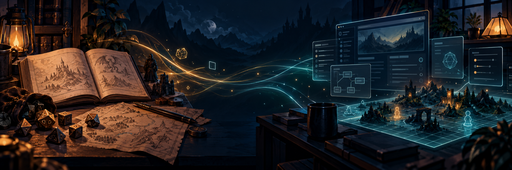

<h1 align="center">
  <picture>
    <source media="(prefers-color-scheme: dark)" srcset="badges/mr-logo-marfil.svg">
    
  </picture>
</h1>

  <strong>Diseño experiencias para Foundry VTT donde la tecnología intenta desaparecer detrás de la partida.</strong> 
  Sistemas completos, aventuras, herramientas y traducciones para mesas virtuales.

  
  
  
  

  <a href="https://manuromera.github.io/ManuRomera/"><b>🌐 Ver como web</b></a> &nbsp;·&nbsp; <a href="https://github.com/ManuRomera?tab=repositories"><b>📚 Todos los repositorios</b></a>

   

<a href="https://github.com/ManuRomera?tab=repositories">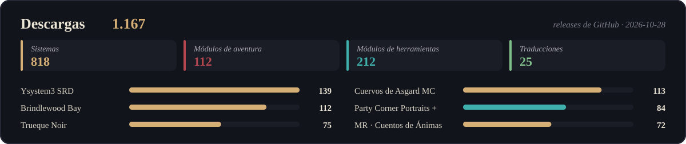</a>

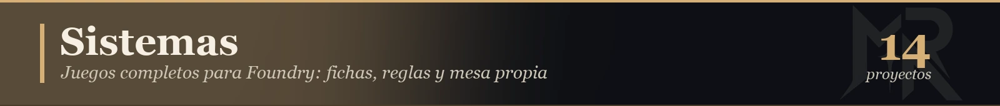

<table>
  <tr>
<td width="50%" valign="top">
<a href="https://github.com/ManuRomera/mr-story-night">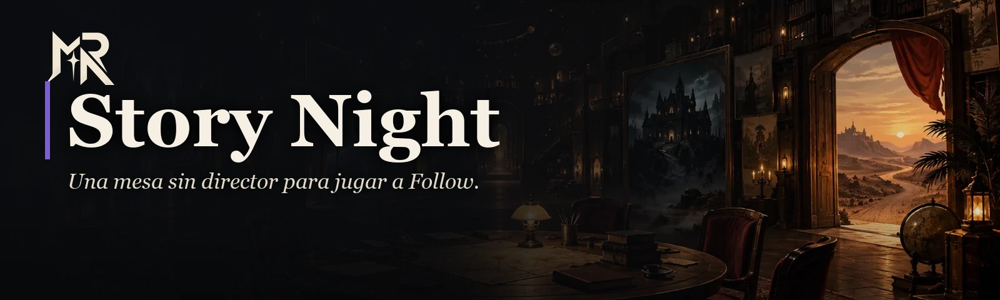</a>
 
<b>MR · Story Night</b> 
Mesa sin director para jugar a <i>Follow</i>: compañía compartida, 24 misiones originales y una sala narrativa que cambia con cada género. 
<a href="https://github.com/ManuRomera/mr-story-night">Repositorio</a> 

</td>
<td width="50%" valign="top">
<a href="https://github.com/ManuRomera/mr-entre-ruinas">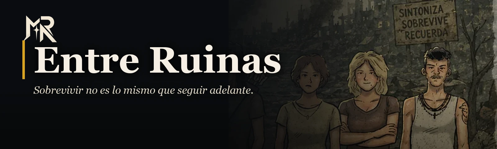</a>
 
<b>MR · Entre Ruinas</b> 
El juego narrativo de MIDRA en Foundry 13/14: Voz rotatoria, refugios, comunidades, crisis y oráculos. 
<a href="https://github.com/ManuRomera/mr-entre-ruinas">Repositorio</a> · <a href="https://manuromera.github.io/mr-entre-ruinas/">Página</a> 

</td>
  </tr>
  <tr>
<td width="50%" valign="top">
<a href="https://github.com/ManuRomera/mr-cuentos-de-animas">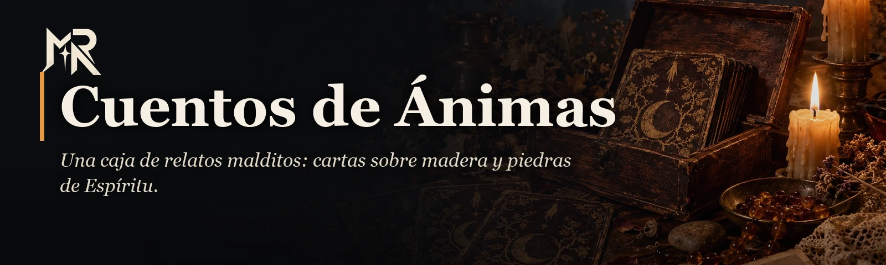</a>
 
<b>MR · Cuentos de Ánimas</b> 
Una caja de relatos malditos: cartas sobre madera, piedras de Espíritu y un modo íntimo 1 + 1. 
<a href="https://github.com/ManuRomera/mr-cuentos-de-animas">Repositorio</a> · <a href="https://manuromera.github.io/mr-cuentos-de-animas/">Página</a> 

</td>
<td width="50%" valign="top">
<a href="https://github.com/ManuRomera/mr-un-momento-unico">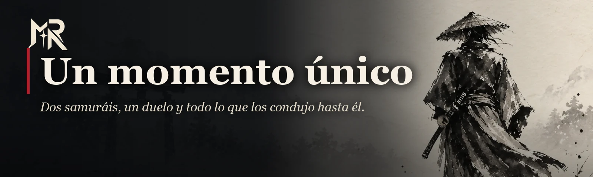</a>
 
<b>MR · Un momento único</b> 
Duelo de samuráis para dos jugadores, sin Director: flashbacks, odio y un Gran Final en cine mudo. 
<a href="https://github.com/ManuRomera/mr-un-momento-unico">Repositorio</a> · <a href="https://manuromera.github.io/mr-un-momento-unico/">Página</a> 

</td>
  </tr>
  <tr>
<td width="50%" valign="top">
<a href="https://github.com/ManuRomera/mr-bruja">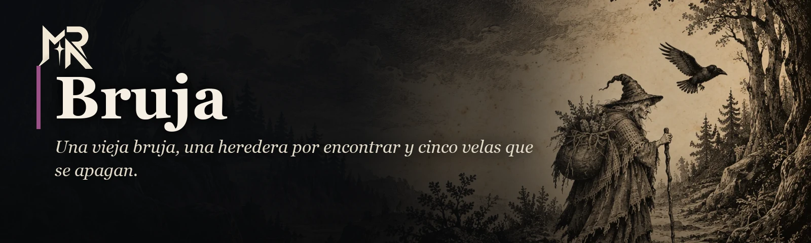</a>
 
<b>MR · Bruja</b> 
Una vieja bruja, una heredera por encontrar y cinco velas que se apagan. Para dos personas. 
<a href="https://github.com/ManuRomera/mr-bruja">Repositorio</a> · <a href="https://manuromera.github.io/mr-bruja/">Página</a> 

</td>
<td width="50%" valign="top">
<a href="https://github.com/ManuRomera/mr-nosotras-las-brujas">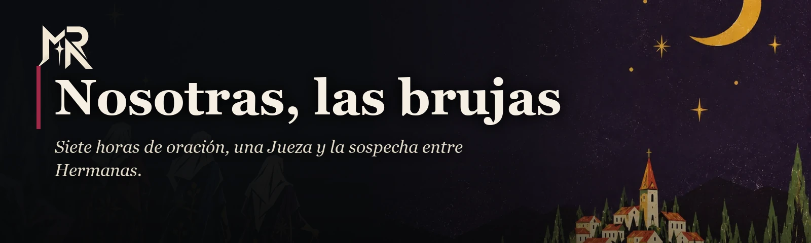</a>
 
<b>MR · Nosotras, las brujas</b> 
Siete horas, una Jueza y las Hermanas: baraja de tarot generada y tracker «Ahora». 
<a href="https://github.com/ManuRomera/mr-nosotras-las-brujas">Repositorio</a> · <a href="https://manuromera.github.io/mr-nosotras-las-brujas/">Página</a> 

</td>
  </tr>
  <tr>
<td width="50%" valign="top">

 
<b>Brindlewood Bay</b> 
El club de las Expertas del Crimen, en castellano: seis misterios, tablero del club y teorías. 
<a href="https://github.com/ManuRomera/brindlewood-bay-foundry">Repositorio</a> · <a href="https://manuromera.github.io/brindlewood-bay-foundry/">Página</a> 

</td>
<td width="50%" valign="top">
<a href="https://github.com/ManuRomera/trueque-noir">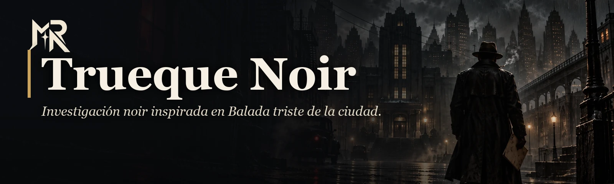</a>
 
<b>Trueque Noir</b> 
Investigación noir con once ambientaciones, ciudad y detectives guiados y mesa compartida del caso. 
<a href="https://github.com/ManuRomera/trueque-noir">Repositorio</a> · <a href="https://manuromera.github.io/trueque-noir/">Página</a> 

</td>
  </tr>
  <tr>
<td width="50%" valign="top">
<a href="https://github.com/ManuRomera/ocho-lanzas">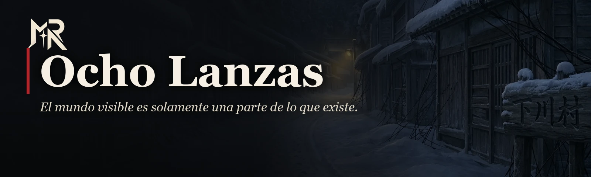</a>
 
<b>Ocho Lanzas</b> 
La Maldición como núcleo visual y mecánico: fichas compactas, ayuda contextual y <i>El Tejido de Yomi</i>. 
<a href="https://github.com/ManuRomera/ocho-lanzas">Repositorio</a> · <a href="https://manuromera.github.io/ocho-lanzas/">Página</a> 

</td>
<td width="50%" valign="top">
<a href="https://github.com/ManuRomera/ruido-blanco">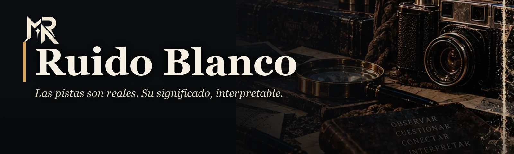</a>
 
<b>Ruido Blanco</b> 
Investigación contemporánea emergente. Las Pistas son reales; su significado, interpretable. 
<a href="https://github.com/ManuRomera/ruido-blanco">Repositorio</a> · <a href="https://manuromera.github.io/ruido-blanco/">Página</a> 

</td>
  </tr>
  <tr>
<td width="50%" valign="top">
<a href="https://github.com/ManuRomera/cuervos-de-asgard-mc">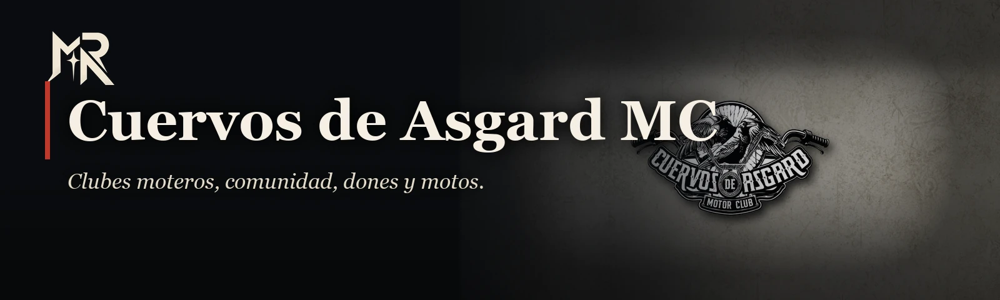</a>
 
<b>Cuervos de Asgard MC</b> 
Clubes moteros, comunidad, dones y motos, con automatizaciones, generadores y compendios. 
<a href="https://github.com/ManuRomera/cuervos-de-asgard-mc">Repositorio</a> · <a href="https://manuromera.github.io/cuervos-de-asgard-mc/">Página</a> 

</td>
<td width="50%" valign="top">
<a href="https://github.com/ManuRomera/imserso-to-the-limit">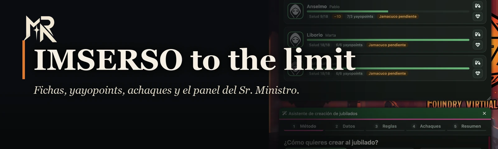</a>
 
<b>IMSERSO to the limit</b> 
Yayopoints, achaques, Jamacuco, peleas y el panel del Sr. Ministro. 
<a href="https://github.com/ManuRomera/imserso-to-the-limit">Repositorio</a> · <a href="https://manuromera.github.io/imserso-to-the-limit/">Página</a> 

</td>
  </tr>
  <tr>
<td width="50%" valign="top">
<a href="https://github.com/ManuRomera/ysystem3-srd">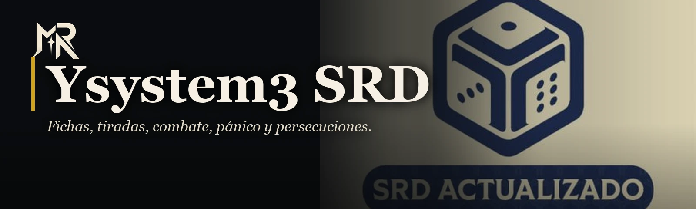</a>
 
<b>Ysystem3 SRD</b> 
Sistema no oficial de Ysystem3: fichas, tiradas, combate, pánico, persecuciones y 10 variantes. 
<a href="https://github.com/ManuRomera/ysystem3-srd">Repositorio</a> · <a href="https://manuromera.github.io/ysystem3-srd/">Página</a> 

</td>
<td width="50%" valign="top">
<a href="https://github.com/ManuRomera/eterno-azul-foundry">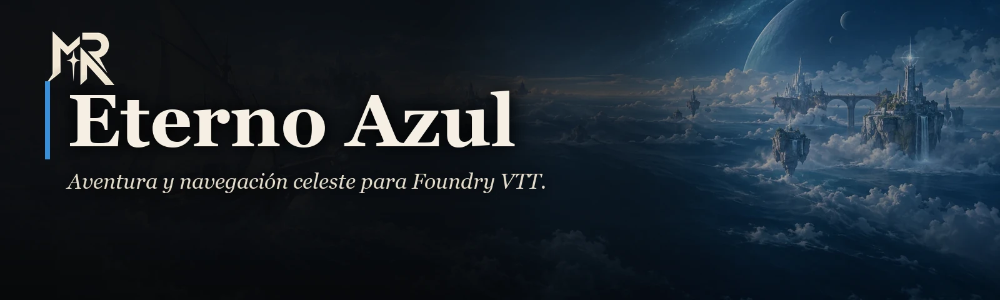</a>
 
<b>Eterno Azul</b> 
Aventura, vínculos y navegación celeste en un sistema nativo. 
<a href="https://github.com/ManuRomera/eterno-azul-foundry">Repositorio</a> · <a href="https://manuromera.github.io/eterno-azul-foundry/">Página</a> 

</td>
  </tr>
</table>

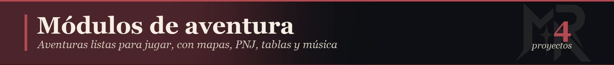

<table>
  <tr>
<td width="50%" valign="top">
<a href="https://github.com/ManuRomera/mr-trono-de-la-sed">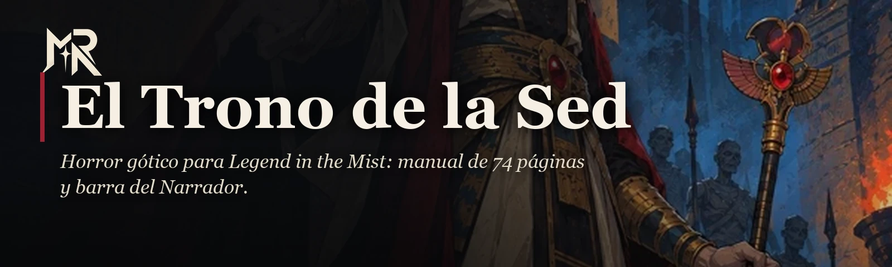</a>
 
<b>MR · El Trono de la Sed</b> 
Horror gótico para Legend in the Mist: manual de 74 páginas, barra del Narrador y música por motivos. 
<a href="https://github.com/ManuRomera/mr-trono-de-la-sed">Repositorio</a> 

</td>
<td width="50%" valign="top">
<a href="https://github.com/ManuRomera/mr-nadir">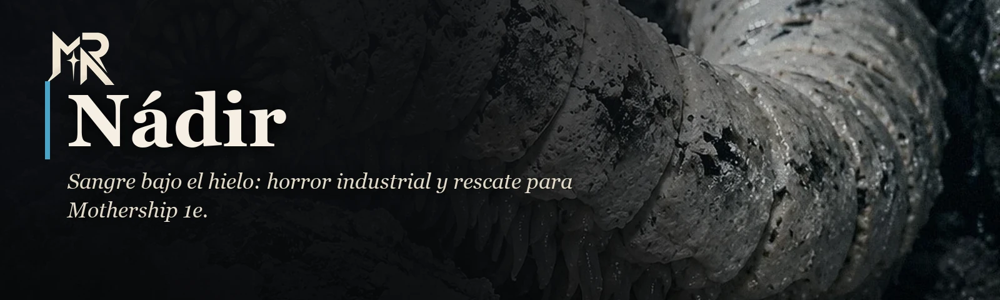</a>
 
<b>MR · Nádir</b> 
Sangre bajo el hielo: horror industrial y rescate para Mothership 1e (3–5 jugadores). 
<a href="https://github.com/ManuRomera/mr-nadir">Repositorio</a> · <a href="https://manuromera.github.io/mr-nadir/">Página</a> 

</td>
  </tr>
  <tr>
<td width="50%" valign="top">

 
<b>Sensa Fine</b> 
Aventura propia para Mosh con paquetizado de lujo: imágenes y audios generados por IA. 
<a href="https://github.com/ManuRomera/Sensa_Fine">Repositorio</a> 

</td>
<td width="50%" valign="top">
<a href="https://github.com/ManuRomera/los-abuelos-de-la-justicia">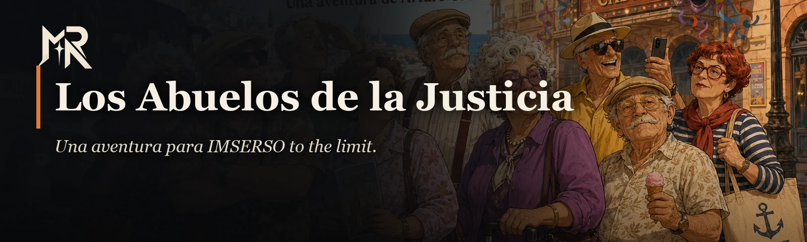</a>
 
<b>Los Abuelos de la Justicia</b> 
La aventura de IMSERSO to the limit, lista para importar en Foundry. 
<a href="https://github.com/ManuRomera/los-abuelos-de-la-justicia">Repositorio</a> 

</td>
  </tr>
</table>

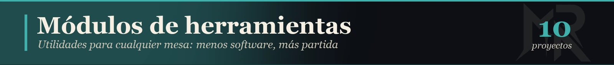

<table>
  <tr>
<td width="50%" valign="top">
<a href="https://github.com/ManuRomera/mr-direccion">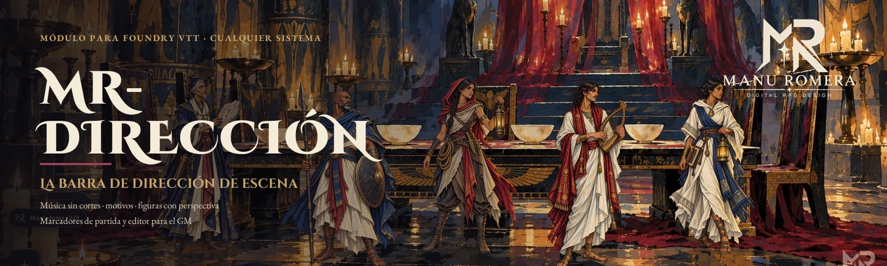</a>
 
<b>MR- Dirección</b> 
Barra de dirección para cualquier sistema: música con fundido cruzado, motivos, figuras con perspectiva, marcadores y editor del GM. 
<a href="https://github.com/ManuRomera/mr-direccion">Repositorio</a> 

</td>
<td width="50%" valign="top">
<a href="https://github.com/ManuRomera/mr-token-stage">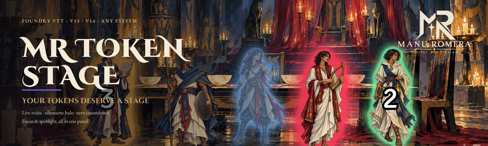</a>
 
<b>MR Token Stage</b> 
Director visual de tokens: escala, grupos, presets, foco, spotlight y deshacer. 
<a href="https://github.com/ManuRomera/mr-token-stage">Repositorio</a> 

</td>
  </tr>
  <tr>
<td width="50%" valign="top">
<a href="https://github.com/ManuRomera/mr-telegram">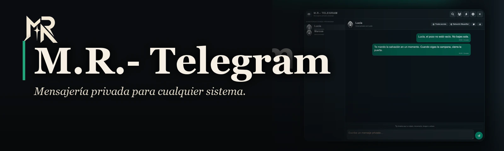</a>
 
<b>M.R. Telegram</b> 
Comunicación privada: mensajería, telegramas, cartas, terminales y tiradas secretas. 
<a href="https://github.com/ManuRomera/mr-telegram">Repositorio</a> · <a href="https://manuromera.github.io/mr-telegram/">Página</a> 

</td>
<td width="50%" valign="top">
<a href="https://github.com/ManuRomera/mr-la-ultima-emision">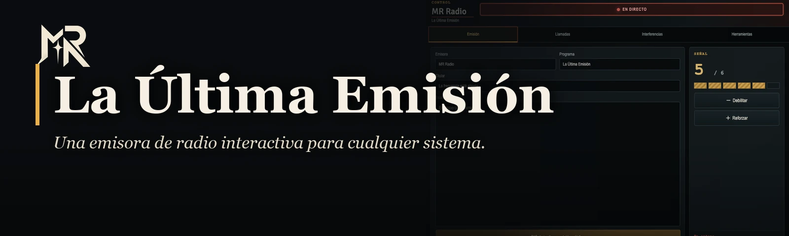</a>
 
<b>MR · La Última Emisión</b> 
Una emisora de radio interactiva y agnóstica de sistema, con overlay sobre la escena. 
<a href="https://github.com/ManuRomera/mr-la-ultima-emision">Repositorio</a> · <a href="https://manuromera.github.io/mr-la-ultima-emision/">Página</a> 

</td>
  </tr>
  <tr>
<td width="50%" valign="top">
<a href="https://github.com/ManuRomera/mr-tahures">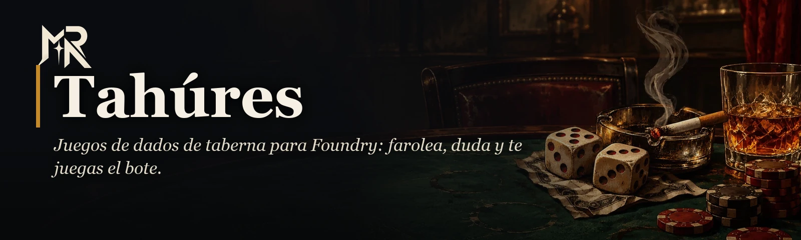</a>
 
<b>MR · Tahúres</b> 
Juegos de dados de taberna con cinco skins, IA con personalidad y bote con dinero. 
<a href="https://github.com/ManuRomera/mr-tahures">Repositorio</a> · <a href="https://manuromera.github.io/mr-tahures/">Página</a> 

</td>
<td width="50%" valign="top">
<a href="https://github.com/ManuRomera/mr-pizarra">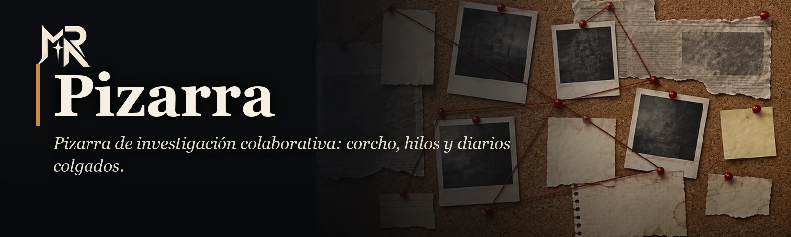</a>
 
<b>MR · Pizarra</b> 
Pizarra de investigación colaborativa: corcho, hilos y diarios colgados con permisos. 
<a href="https://github.com/ManuRomera/mr-pizarra">Repositorio</a> · <a href="https://manuromera.github.io/mr-pizarra/">Página</a> 

</td>
  </tr>
  <tr>
<td width="50%" valign="top">
<a href="https://github.com/ManuRomera/mr-standee-portrait">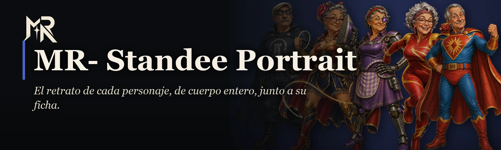</a>
 
<b>MR · Standee Portrait</b> 
Retrato de cuerpo entero con bandera de fondo para cualquier sistema. 
<a href="https://github.com/ManuRomera/mr-standee-portrait">Repositorio</a> · <a href="https://manuromera.github.io/mr-standee-portrait/">Página</a> 

</td>
<td width="50%" valign="top">
<a href="https://github.com/ManuRomera/party-corner-portraits-plus">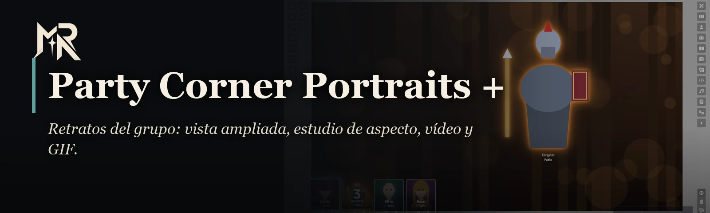</a>
 
<b>Party Corner Portraits +</b> 
Retratos del grupo: vista ampliada, estudio de aspecto, vídeo y GIF. 
<a href="https://github.com/ManuRomera/party-corner-portraits-plus">Repositorio</a> 

</td>
  </tr>
  <tr>
<td width="50%" valign="top">
<a href="https://github.com/ManuRomera/camc-persecuciones">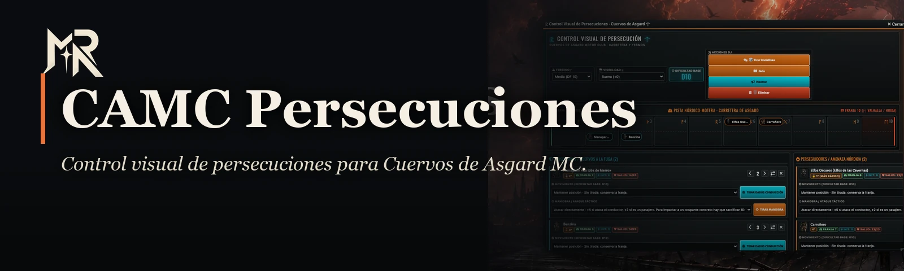</a>
 
<b>CAMC Persecuciones</b> 
Una pista visual para las persecuciones de Cuervos de Asgard MC. 
<a href="https://github.com/ManuRomera/camc-persecuciones">Repositorio</a> · <a href="https://manuromera.github.io/camc-persecuciones/">Página</a> 

</td>
<td width="50%" valign="top">
<a href="https://github.com/ManuRomera/mausritter-damage-helper">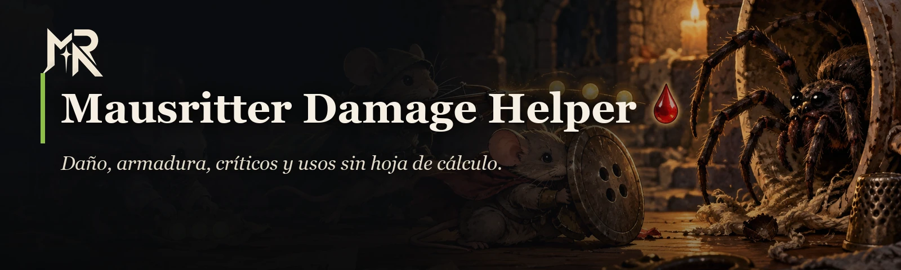</a>
 
<b>Mausritter Damage Helper</b> 
Daño, armadura, críticos y gasto de usos para Mausritter, sin hojas de cálculo. 
<a href="https://github.com/ManuRomera/mausritter-damage-helper">Repositorio</a> · <a href="https://manuromera.github.io/mausritter-damage-helper/">Página</a> 

</td>
  </tr>
  <tr>
<td width="50%" valign="top">
<a href="https://github.com/ManuRomera/mausritter-wdip">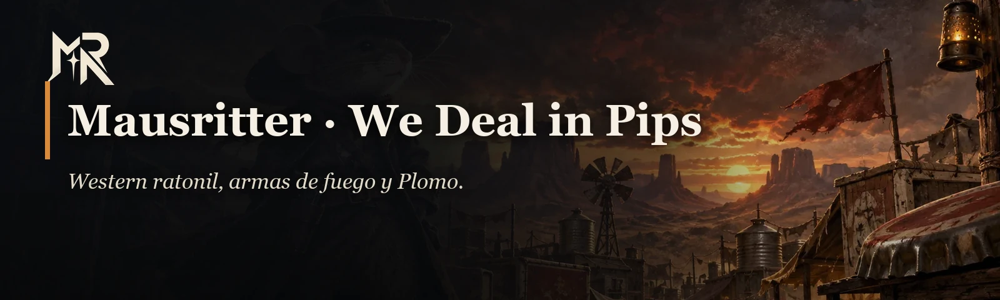</a>
 
<b>Mausritter · We Deal in Pips</b> 
We Deal in Pips: western ratonil con armas de fuego, Plomo y estética de cartel de recompensa. 
<a href="https://github.com/ManuRomera/mausritter-wdip">Repositorio</a> · <a href="https://manuromera.github.io/mausritter-wdip/">Página</a> 

</td>
<td width="50%"></td>
  </tr>
</table>

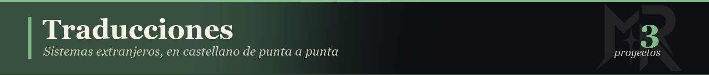

<table>
  <tr>
<td width="50%" valign="top">
<a href="https://github.com/ManuRomera/mr-litm-es">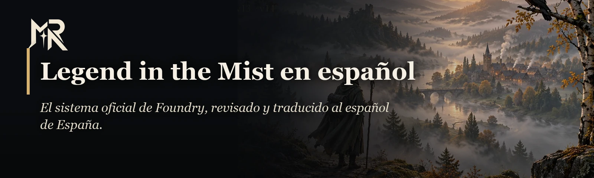</a>
 
<b>Legend in the Mist ES</b> 
Legend in the Mist: interfaz revisada y unificada, textos fijos y la ventana «Cómo jugar». 
<a href="https://github.com/ManuRomera/mr-litm-es">Repositorio</a> · <a href="https://manuromera.github.io/mr-litm-es/">Página</a> 

</td>
<td width="50%" valign="top">
<a href="https://github.com/ManuRomera/mr-mothership-es">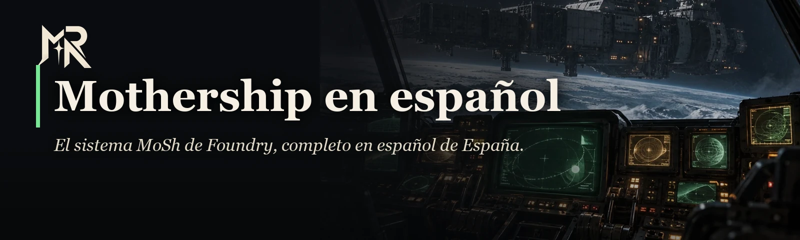</a>
 
<b>Mothership ES</b> 
Mothership (MoSh): interfaz, hojas, chat y compendios de 0e y 1e. 
<a href="https://github.com/ManuRomera/mr-mothership-es">Repositorio</a> · <a href="https://manuromera.github.io/mr-mothership-es/">Página</a> 

</td>
  </tr>
  <tr>
<td width="50%" valign="top">
<a href="https://github.com/ManuRomera/grimwild-es">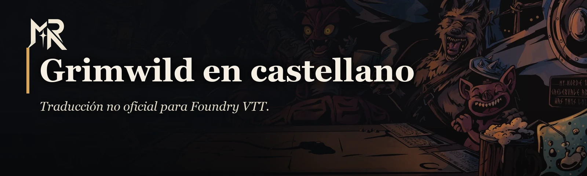</a>
 
<b>Grimwild ES</b> 
Grimwild: interfaz, compendios, creación guiada, herramientas de DJ y accesibilidad. 
<a href="https://github.com/ManuRomera/grimwild-es">Repositorio</a> · <a href="https://manuromera.github.io/grimwild-es/">Página</a> 

</td>
<td width="50%"></td>
  </tr>
</table>

---

<h2 align="center">🧭 Lo que intento repetir en todos mis proyectos</h2>

<table>
  <tr>
    <td width="33%" valign="top"><b>Una sola herramienta para Foundry 13/14</b> Cuando es viable, sin duplicar versiones.</td>
    <td width="33%" valign="top"><b>Ventanas con memoria</b> Recuerdan dónde estaban y cuánto medían.</td>
    <td width="33%" valign="top"><b>Información bajo demanda</b> Hover o clic derecho; buen uso del espacio de pantalla.</td>
  </tr>
  <tr>
    <td valign="top"><b>Accesibilidad</b> Teclado, contraste y reducción de movimiento.</td>
    <td valign="top"><b>Automatizar lo repetitivo</b> Sin automatizar las decisiones narrativas.</td>
    <td valign="top"><b>Identidad propia</b> Una identidad visual distinta para cada juego.</td>
  </tr>
</table>

<b><i>Menos software visible. Más partida.</i></b>

Gran parte de estos proyectos se desarrolla con apoyo de herramientas de IA para programación, diseño y revisión, siempre bajo mi dirección y revisión final. 
Banners y cabeceras generados con <code>scripts/make-banners.py</code>, <code>scripts/make-sections.py</code> y <code>scripts/portada.json</code>; esta página con <code>scripts/make-portada.py</code>.

